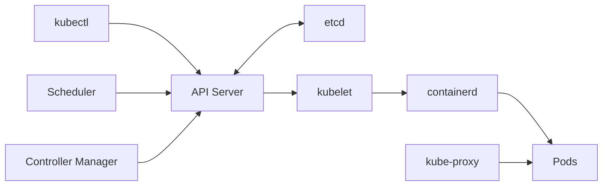

# Kubernetes Architecture (verified on Minikube v1.39, K8s v1.37)

- Control plane (static Pods in kube-system): etcd, kube-apiserver, kube-scheduler, kube-controller-manager.
- Node components: kubelet (systemd service, not a Pod), containerd, kube-proxy, CNI (kindnet), CoreDNS.
- Static Pods use hostNetwork, so etcd's Pod IP = node IP (192.168.49.2).
- Service CIDR (apiserver flag): 10.96.0.0/12.
- Reconciliation: deleted the coredns Pod; a controller recreated it.
